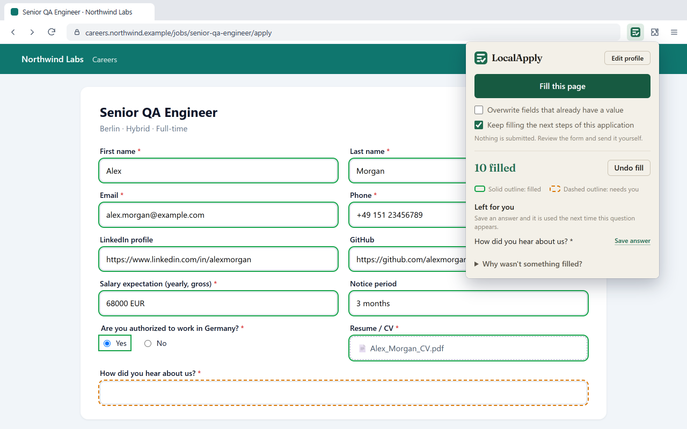
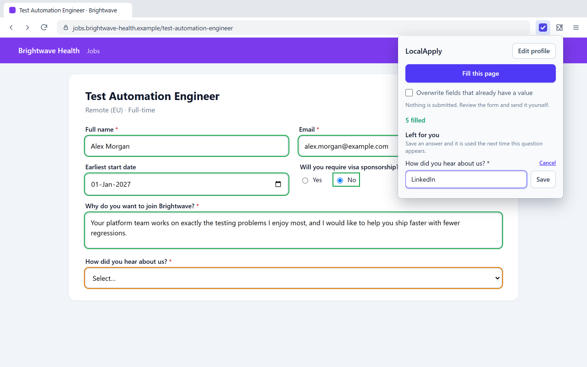
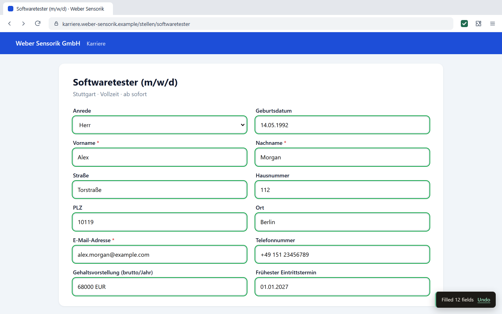
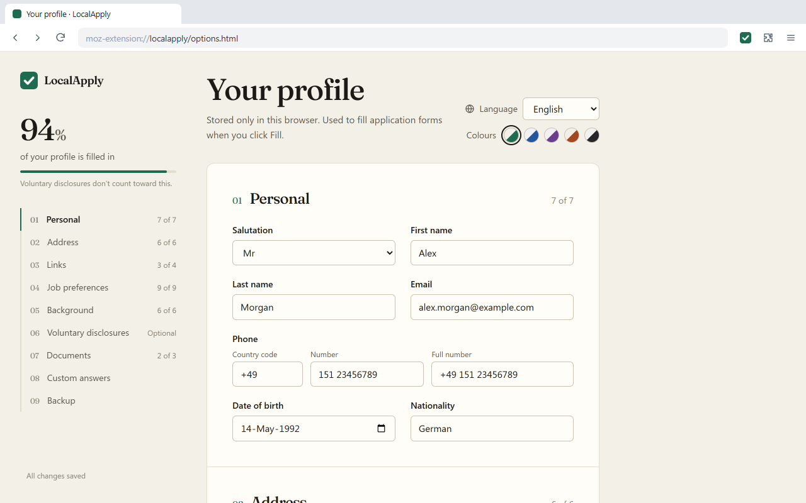

# LocalApply

LocalApply is a Chrome and Firefox extension that fills job application forms from a profile you save once. One click fills name, contact details, address, links, salary expectation, availability, education, CV and your saved answers. You review the form and submit it yourself.

Everything stays in the browser: no account, no server, no AI service, no network requests.

**Current version:** 0.10.1 · **Browsers:** Chrome, Edge, Brave and Firefox · **Languages:** English, German, French, Spanish, Italian, Dutch, Portuguese, Polish · **License:** MIT

[](https://github.com/somewordshere/LocalApply/actions/workflows/verify.yml) [](https://chromewebstore.google.com/detail/localapply-%E2%80%93-private-job/codbdjbapnhnfglckfejehkpegjilfpg) [](https://addons.mozilla.org/en-US/firefox/addon/localapply-job-autofill/) [](releases/v0.10.1/localapply-0.10.1-chrome.zip) [](releases/v0.10.1/localapply-0.10.1-firefox.zip)

**[What’s new →](WHATS-NEW.md)**

[Screenshots](#-screenshots) · [Features](#features) · [Install](#installation) · [Use](#-how-to-use-it) · [Privacy](#-privacy) · [Releases](#-recent-releases) · [Development](#-development) · [Docs](#-docs) · [License](#-license)

## 📸 Screenshots



| Saved answers                                                      | Any language                                                                            | Your profile                                         |
| ------------------------------------------------------------------ | --------------------------------------------------------------------------------------- | ---------------------------------------------------- |
|  |  |  |

## Features

- **Fills the repetitive part:** name, email, phone (including country-code pickers), address, date of birth, LinkedIn, GitHub, Xing and portfolio links, salary expectation, notice period, start date, years of experience, work authorisation, visa sponsorship and relocation questions, work history and education (one entry per block, even on forms that list several jobs or schools), highest education level, spoken languages and their level, driving licence, travel and salary-range questions, CV and cover letter.
- **Works in eight languages:** recognises form labels in English, German, French, Spanish, Italian, Dutch, Portuguese and Polish, and the interface itself speaks all eight.
- **Writes to the right company:** put `{company}` and `{position}` in your cover letter or saved answers and they are replaced with the employer and job title from the page, even when the form sits in an embedded frame.
- **Keeps track:** every application it fills is noted in a log in your browser, with date, company, job title, link and the job description, plus a status and your notes; export it as CSV. The popup tells you when you applied to the same employer before. You can turn it off.
- **Follows multi-page applications:** after you fill the first step, the next steps of the same application are filled as they appear. When the form has fewer job or school blocks than your profile, it offers to add them.
- **Answers each question once:** type or pick your reply to a question like "Why do you want to join us?" and LocalApply offers to save it; next time it is filled in for you. The list on the profile page shows how often each answer was used.
- **Fills single fields:** right-click any form field and choose **Fill this field with** to pick one of your details or saved answers.
- **Shows what it did:** filled fields get a solid green outline, open required questions a dashed amber one. **Undo** puts everything back.
- **Never submits:** it doesn't press Submit or Next, doesn't tick consent boxes, and leaves fields you already filled alone.
- **Several profiles:** keep one per language or kind of job (a German CV, a QA one) and pick it in the popup before you fill.
- **Looks the way you like:** five colour palettes (Forest, Ocean, Plum, Clay, Graphite), and a light or dark theme that follows your system or stays the way you set it.

It works on ordinary company career pages and on Greenhouse, Ashby, Personio, Recruitee and Teamtailor, with site-specific handling for Workday, Lever, SmartRecruiters, SAP SuccessFactors and LinkedIn Easy Apply. Workable, iCIMS, Taleo, softgarden, d.vinci, rexx, Umantis and JOIN are recognised too; their handling hasn't been tried on live postings yet, so reports are welcome: **Why wasn't something filled?** in the popup can save a copy of a form for an issue.

## Installation

- **Store installation:** install LocalApply from the [Chrome Web Store](https://chromewebstore.google.com/detail/localapply-%E2%80%93-private-job/codbdjbapnhnfglckfejehkpegjilfpg) (also for Edge and Brave) or [Firefox Add-ons](https://addons.mozilla.org/en-US/firefox/addon/localapply-job-autofill/).
- **Manual installation:** download the latest [Chrome build](releases/v0.10.1/localapply-0.10.1-chrome.zip) or [Firefox build](releases/v0.10.1/localapply-0.10.1-firefox.zip).
  - Chrome, Edge, Brave: unzip it, open `chrome://extensions`, turn on Developer mode, choose **Load unpacked** and pick the unzipped folder.
  - Firefox: open `about:debugging#/runtime/this-firefox`, choose **Load Temporary Add-on** and pick the zip. It is removed when Firefox restarts; for a permanent install use the store version, or Firefox Developer Edition with `xpinstall.signatures.required` set to `false`.

Each version's folder in [`releases/`](releases/) also has the source zip, release notes and checksums.

## 🧭 How to use it

1. Enter your details once on the profile page. Installing LocalApply opens a welcome page that explains it and leads there; later, click the LocalApply toolbar button, then **Edit profile**.
2. Open a job application, click the LocalApply toolbar button and then **Fill this page**, or press **Alt+Shift+F**.
3. Check the result, finish the outlined questions, and submit the form yourself. Answers you type in are offered for saving, so the next form gets them.

Your profile can be exported to a file and imported again, or deleted with one click.

## 🔐 Privacy

Your profile, documents and saved answers are stored in your browser and never leave it. LocalApply makes no network requests, has no account and no analytics, and reads a page only once you ask it to fill one (after that, it notices answers you type so it can offer to save them; nothing is kept unless you press Save). It needs access to all websites because job applications are hosted on thousands of employer and recruiting sites, often inside embedded frames. Read the full [privacy policy](PRIVACY.md).

## 📦 Recent releases

| Version | Highlights                                                                                                     | Download                                                                                                            |
| ------- | -------------------------------------------------------------------------------------------------------------- | ------------------------------------------------------------------------------------------------------------------- |
| 0.10.1  | The welcome page's practice form types in a made-up applicant                                                  | [Chrome](releases/v0.10.1/localapply-0.10.1-chrome.zip) · [Firefox](releases/v0.10.1/localapply-0.10.1-firefox.zip) |
| 0.10.0  | Fills multi-page applications step by step, status and notes in the log, adds job blocks, more job sites       | [Chrome](releases/v0.10.0/localapply-0.10.0-chrome.zip) · [Firefox](releases/v0.10.0/localapply-0.10.0-firefox.zip) |
| 0.9.1   | Neater dropdowns and phone boxes, a crisper welcome title                                                      | [Chrome](releases/v0.9.1/localapply-0.9.1-chrome.zip) · [Firefox](releases/v0.9.1/localapply-0.9.1-firefox.zip)     |
| 0.9.0   | Learns answers you type, right-click to fill a field, a note when you applied before, a welcome page           | [Chrome](releases/v0.9.0/localapply-0.9.0-chrome.zip) · [Firefox](releases/v0.9.0/localapply-0.9.0-firefox.zip)     |
| 0.8.2   | New icon: a filled-in form                                                                                     | [Chrome](releases/v0.8.2/localapply-0.8.2-chrome.zip) · [Firefox](releases/v0.8.2/localapply-0.8.2-firefox.zip)     |
| 0.8.1   | Store name and summary lead with free, no account, no subscription                                             | [Chrome](releases/v0.8.1/localapply-0.8.1-chrome.zip) · [Firefox](releases/v0.8.1/localapply-0.8.1-firefox.zip)     |
| 0.8.0   | Work history and education lists, several profiles                                                             | [Chrome](releases/v0.8.0/localapply-0.8.0-chrome.zip) · [Firefox](releases/v0.8.0/localapply-0.8.0-firefox.zip)     |
| 0.7.0   | Spoken languages, driving licence, travel and salary range, {company}/{position} placeholders, application log | [Chrome](releases/v0.7.0/localapply-0.7.0-chrome.zip) · [Firefox](releases/v0.7.0/localapply-0.7.0-firefox.zip)     |
| 0.6.2   | Profile page opens on install, palette-coloured icon, store pages in eight languages                           | [Chrome](releases/v0.6.2/localapply-0.6.2-chrome.zip) · [Firefox](releases/v0.6.2/localapply-0.6.2-firefox.zip)     |
| 0.6.1   | Theme switch: System, Light or Dark                                                                            | [Chrome](releases/v0.6.1/localapply-0.6.1-chrome.zip) · [Firefox](releases/v0.6.1/localapply-0.6.1-firefox.zip)     |
| 0.6.0   | Phone in three linked boxes, sexual orientation, and a centered profile page                                   | [Chrome](releases/v0.6.0/localapply-0.6.0-chrome.zip) · [Firefox](releases/v0.6.0/localapply-0.6.0-firefox.zip)     |
| 0.5.0   | Highest education level, and five colour palettes with dark versions                                           | [Chrome](releases/v0.5.0/localapply-0.5.0-chrome.zip) · [Firefox](releases/v0.5.0/localapply-0.5.0-firefox.zip)     |
| 0.4.1   | Security hardening: the interface can no longer write raw HTML into a page                                     | [Chrome](releases/v0.4.1/localapply-0.4.1-chrome.zip) · [Firefox](releases/v0.4.1/localapply-0.4.1-firefox.zip)     |
| 0.4.0   | The interface in eight languages, a new paper-and-ink look, and a profile page with a section index            | [Chrome](releases/v0.4.0/localapply-0.4.0-chrome.zip) · [Firefox](releases/v0.4.0/localapply-0.4.0-firefox.zip)     |
| 0.3.0   | Enter your phone number as one full number or as code plus number                                              | [Chrome](releases/v0.3.0/localapply-0.3.0-chrome.zip) · [Firefox](releases/v0.3.0/localapply-0.3.0-firefox.zip)     |
| 0.2.1   | Firefox build that matches the addons.mozilla.org listing                                                      | [Chrome](releases/v0.2.1/localapply-0.2.1-chrome.zip) · [Firefox](releases/v0.2.1/localapply-0.2.1-firefox.zip)     |
| 0.2.0   | Undo, outlines that don't rely on colour, and a dozen filling fixes                                            | [Chrome](releases/v0.2.0/localapply-0.2.0-chrome.zip) · [Firefox](releases/v0.2.0/localapply-0.2.0-firefox.zip)     |
| 0.1.0   | First release: one-click filling in eight languages, saved answers and CV upload                               | [Chrome](releases/v0.1.0/localapply-0.1.0-chrome.zip) · [Firefox](releases/v0.1.0/localapply-0.1.0-firefox.zip)     |

See [What’s new](WHATS-NEW.md) for every release, or the [changelog](CHANGELOG.md) for the technical history.

## 🧪 Development

Node.js 22 or newer.

```bash
npm install
npm run dev            # Chrome with hot reload (npm run dev:firefox for Firefox)
npm run check          # typecheck, lint, format check, unit tests, Mozilla's add-on linter
npm run test:e2e       # loads the built extension in Chromium (first time: npx playwright install chromium)
```

| Command                 | What it does                                                            |
| ----------------------- | ----------------------------------------------------------------------- |
| `npm run build`         | Builds the Chrome extension into `.output/chrome-mv3`                   |
| `npm run build:firefox` | Builds the Firefox add-on into `.output/firefox-mv2`                    |
| `npm run package`       | Zips both builds plus the source bundle into `.output/`                 |
| `npm test`              | Unit tests (jsdom)                                                      |
| `npm run lint`          | ESLint                                                                  |
| `npm run format`        | Prettier                                                                |
| `npm run icons`         | Redraws the extension and store icons                                   |
| `npm run store-assets`  | Renders store screenshots and the Chrome promo tile                     |
| `npm run release`       | Checks, builds and writes `releases/v<version>/`, then commits and tags |

### Project layout

```
entrypoints/        extension entry points: background, content script, popup, profile (options) page
src/
  core/             messages passed between popup, background and pages
  engine/           finds form fields, matches them to profile data and fills them
    rules/          field definitions and label phrases, one file per language in rules/locales/
  adapters/         per-site knowledge, one file per applicant-tracking system
  profile/          profile data model, storage and version migrations
  ui/               shared styles and React components
tests/
  unit/             engine and profile tests (Vitest + jsdom)
  e2e/              end-to-end test of the built extension (Playwright)
  fixtures/         sample application forms
scripts/            icons, store images, release
store/              store listings, screenshots and promo images for Firefox and Chrome
releases/           shipped versions, one folder each
docs/               architecture, extending, releasing
```

## 📚 Docs

- [Architecture](docs/architecture.md): how a fill works and where each piece lives
- [Extending](docs/extending.md): adding a profile field, a language, a job site, a profile migration
- [Releasing](docs/releasing.md): versioning, changelog, building a release, uploading to the stores
- [Store listings](store/README.md): what goes into each store form
- [Privacy policy](PRIVACY.md)
- [What’s new](WHATS-NEW.md) and [changelog](CHANGELOG.md)

## 📄 License

LocalApply is released under the [MIT License](LICENSE).
